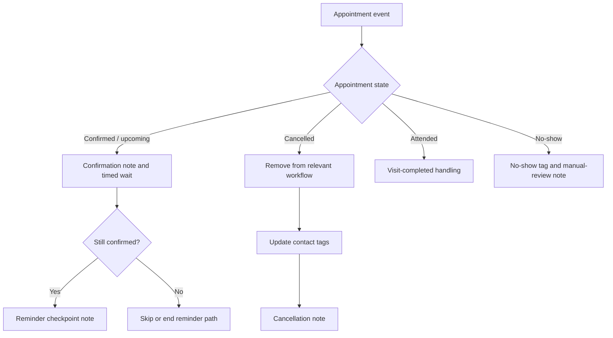

# BrightSmile Appointment Lifecycle Automation

*GoHighLevel workflow design, appointment-state handling, and lifecycle testing.*

> **Portfolio demonstration:** BrightSmile Dental Clinic and all test contacts are fictional. This project documents a configured and tested GoHighLevel demonstration, not a live clinic deployment or a production-ready system.

## Overview

This project demonstrates appointment lifecycle automation patterns in GoHighLevel (GHL): confirmation/reminder handling, cancellation handling, visit-completed handling, and no-show follow-up. The goal was to model appointment-state changes, inspect workflow execution, and document expected behavior alongside defects discovered during testing.

## Workflows

| Workflow | Purpose | Status in supplied evidence |
|---|---|---|
| `BrightSmile | Appointment Reminders` | Confirmation note, timed waits, and confirmation checks | Published; T1 pending at last recorded verification |
| `BrightSmile | Cancellation Handling` | Respond to a cancelled appointment, update tags, and record a note | Published; cancellation test recorded as passed |
| `BrightSmile | Visit Completed` | Handle attended/completed appointments | Published; attendance test recorded as passed |
| `BrightSmile | No-Show Follow-up` | Tag no-shows and record a manual-review note | Published; no-show test recorded as passed |

The related lead-intake and appointment-booking workflows belong to the broader BrightSmile demonstration; this repository focuses on appointment lifecycle behavior.

## Architecture

This diagram summarizes the demonstrated intent; actual behavior and limitations are documented below. Reminder checkpoint actions are notes, not outbound messages.

## Testing summary

| Test | Area | Recorded result |
|---|---|---|
| T1 | Confirmation/reminder path and 24-hour checkpoint | **Pending** at last verification; do not treat as passed without checking the actual execution log |
| T2 | Reminder behavior when the 24-hour wait was already overdue | Passed |
| T3 | Cancellation handling | Passed |
| T4 | Attendance handling | Passed |
| T5 | No-show handling | Passed |
| T7 | Rescheduling | Passed; old enrollment ended after appointment change and a new enrollment began with a recalculated wait |
| T8 | Re-entry after first run ended | Passed |
| T9 | Multiple appointments for one contact | Test completed; significant limitation found |

These are recorded demonstration test outcomes, not production performance metrics.

## Important findings and limitations

- **Multiple appointments per contact:** Cancelling one appointment ended reminder runs for another appointment belonging to the same contact. Tag and removal actions operate at contact level rather than being isolated per appointment.
- **Tag cleanup:** Attendance and no-show handling left `demo-appt-confirmed` on the contact.
- **Rescheduling:** Rescheduling produced a duplicate confirmation note.
- **Opportunity stages:** Lifecycle workflows do not move an opportunity stage.
- **Messaging:** Reminder checkpoints are notes, not actual email or SMS messages.
- **Production readiness:** Real outbound messaging, message templates, and consent handling were not tested.

Before production use, the design would need appointment-specific state handling, reliable tag cleanup, duplicate-note prevention, defined opportunity-stage behavior, and end-to-end testing of outbound messages and consent rules.

## Safety and privacy

- The clinic and test contacts are fictional portfolio examples.
- Public screenshots should not expose contact names, emails, phone numbers, record IDs, or unrelated account details.
- Selected execution screenshots have contact-name columns obscured. Review every image before publishing.
- Workflow publication status is not proof of production readiness.

## Evidence

See [`documentation/evidence-index.md`](documentation/evidence-index.md) for the screenshot index and items intentionally excluded from the public selection.

## Tools

- GoHighLevel: workflow builder, appointment/calendar configuration, enrollment history, execution logs, and contact records
- Markdown and Mermaid for project documentation

## Scope and disclosure

This is a fictional portfolio demonstration created to show workflow design, testing, and honest defect documentation. It was not deployed for a real dental clinic, and no real-world performance claims are made.
