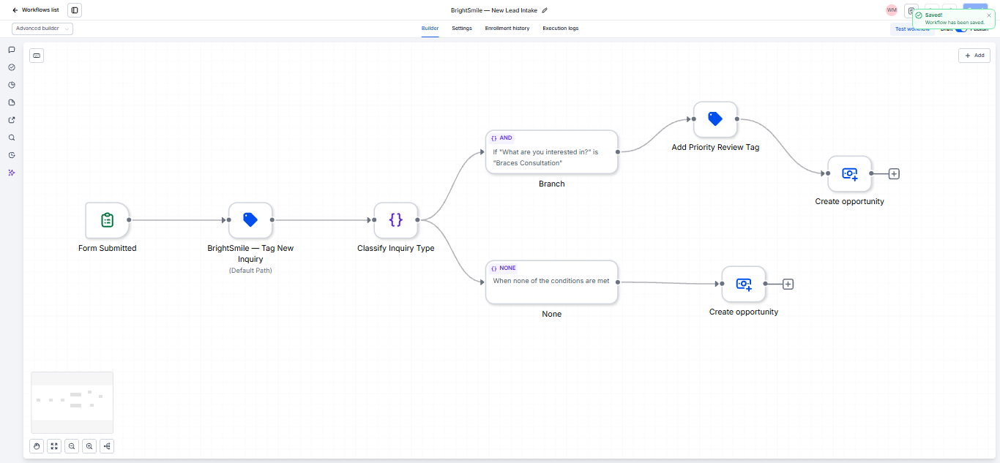
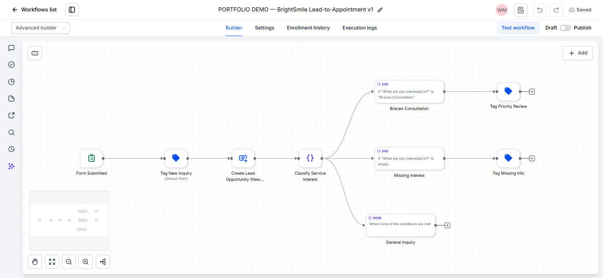
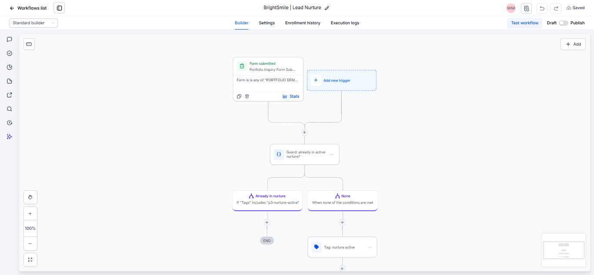
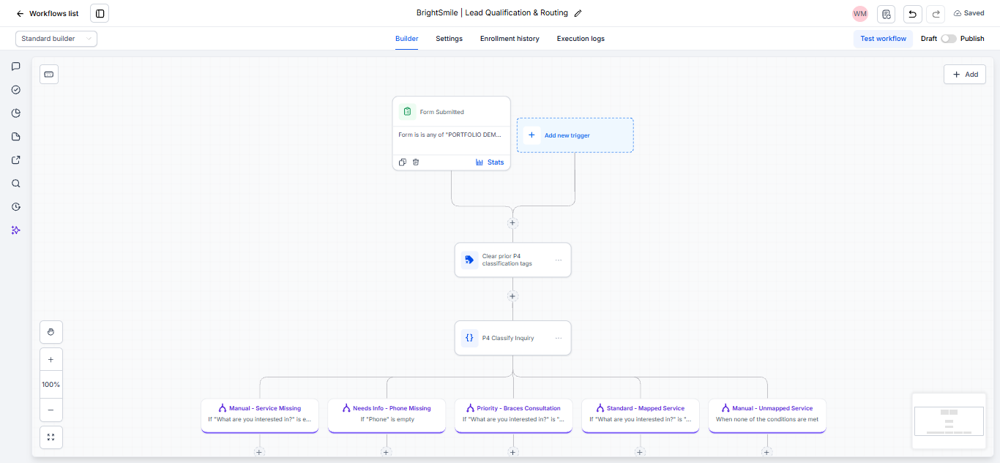

# GoHighLevel Automation Portfolio

A portfolio hub for CRM operations and GoHighLevel workflow automation. The projects use a fictional BrightSmile Dental Clinic scenario to demonstrate connected CRM processes, workflow design, testing, and documentation.

> **Portfolio standards:** All examples are fictional demonstrations. Workflow statuses and tests are reported as observed; unverified behavior and known limitations are called out explicitly. No real patient data is intended for publication. Raw account exports and unrelated screenshots are excluded from this repository package.

## Projects

| Folder | Project | Focus | Evidence/status |
|---|---|---|---|
| [`BrightSmile-CRM-Workflow-Automation-Demo/`](BrightSmile-CRM-Workflow-Automation-Demo/) | BrightSmile CRM & Workflow Automation Demo | Foundational lead intake, missing-information review, CRM pipeline, follow-up task | Selected builder and execution-log screenshots; sanitized workbook |
| [`Project-1-Lead-to-Appointment-System/`](Project-1-Lead-to-Appointment-System/) | Project 1 — Lead-to-Appointment System | Form intake, tags, opportunity creation, appointment-driven stage update | Workflow and execution evidence; cancellation-stage limitation documented |
| [`Project-2-Appointment-Lifecycle-Automation/`](Project-2-Appointment-Lifecycle-Automation/) | Project 2 — Appointment Lifecycle Automation | Reminder checkpoints, cancellation, attendance, no-show handling | Selected redacted evidence; multiple-appointment defect and pending T1 documented |
| [`Project-3-Lead-Nurture-Reengagement/`](Project-3-Lead-Nurture-Reengagement/) | Project 3 — Lead Nurture & Re-engagement | Rule-based nurture, stop tags, manual re-engagement eligibility | Workflow/canvas/log/status screenshots; reply-stop limitation documented |
| [`Project-4-Lead-Qualification-Routing/`](Project-4-Lead-Qualification-Routing/) | Project 4 — Lead Qualification & Routing | Data-quality checks, classification tags, manual review | Five builder-test scenarios reported passing; live form trigger not verified |

## Screenshot Preview

The selected proof images below are embedded directly from each project's `evidence/` folder. Open a project README for its larger, topic-by-topic gallery and full documentation.

### BrightSmile CRM & Workflow Automation Demo

### Project 1 — Lead-to-Appointment System

### Project 2 — Appointment Lifecycle Automation

### Project 3 — Lead Nurture & Re-engagement

### Project 4 — Lead Qualification & Routing

---

## Skills demonstrated

- CRM pipeline and contact-data organization.
- Workflow triggers, If/Else branches, tags, notes, opportunity actions, and appointment-state handling.
- Scenario-based workflow testing and execution-log review.
- Evidence selection, documentation, Mermaid architecture diagrams, and limitations reporting.
- Privacy-aware portfolio packaging and separation of demo data from raw account exports.

## Tools

GoHighLevel · GitHub · Markdown · Mermaid · Excel/Google Sheets

## Project status notes

- Projects 1 and 4 have documented limitations; Project 1's test appointment was cancelled but the opportunity remained at Appointment Booked.
- Project 2's 24-hour reminder checkpoint was pending in the supplied project record, and a multiple-appointments test exposed contact-level cross-impact.
- Project 3 does not send outbound messages; its native reply-stop test was blocked.
- Project 4 uses rule-based logic, not a live AI model. Its real form-submission trigger remains unverified because the workflow is kept in Draft.

## Repository hygiene

This compiled public package excludes raw audit-log exports, raw opportunity/contact exports, account-level contact/task details, and duplicate screenshot files. PNG screenshots are copied at original resolution without recompression. Review screenshots one final time before publishing to GitHub.
